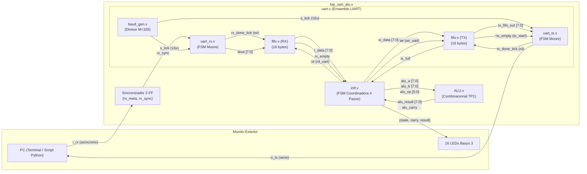
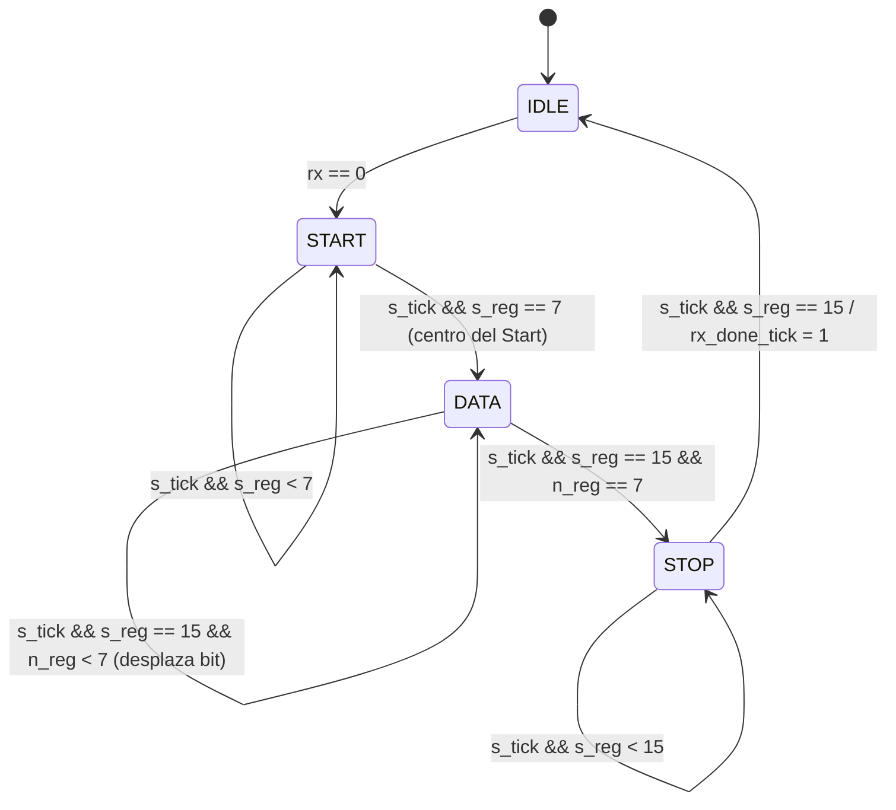
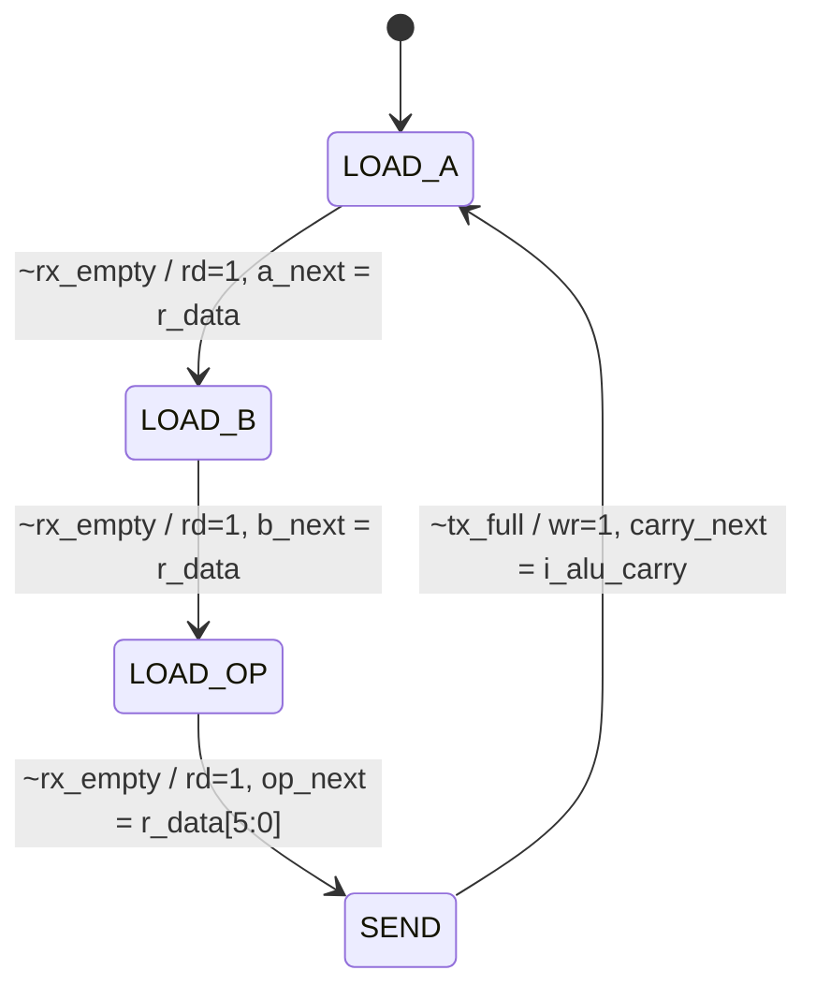

# Informe Técnico de Laboratorio: Implementación de UART + Interfaz + ALU en FPGA

**Asignatura:** Arquitectura de Computadoras  
**Trabajo Práctico:** N° 2 — Sistema de Procesamiento Aritmético con Comunicación Serie Asíncrona (UART)  
**Plataforma de Hardware:** Digilent Basys 3 (FPGA Xilinx Artix-7 XC7A35T-1CPG236C)  
**Lenguaje de Descripción de Hardware:** Verilog HDL (IEEE 1364-2001)  
**Entorno de Desarrollo y Simulación:** Xilinx Vivado / Icarus Verilog (`iverilog`) + GTKWave  

---

## 1. Introducción y Objetivos

El presente trabajo práctico consiste en el diseño, implementación y verificación de un sistema embebido sobre FPGA capaz de realizar operaciones aritmético-lógicas solicitadas desde una computadora personal (PC) a través de una interfaz de comunicación serie asíncrona estándar (**UART**).

El núcleo de cálculo utilizado es la **Unidad Aritmético-Lógica (ALU)** de 8 bits desarrollada en el Trabajo Práctico N° 1. El desafío principal radica en la integración de dicho bloque combinacional con un canal serie full-duplex, resolviendo la disparidad de velocidades y dominios temporales:
- La lógica interna y el cristal de la FPGA operan a **$100\text{ MHz}$** ($T_{clk} = 10\text{ ns}$).
- El canal serie físico transmite los datos bit a bit a una tasa de **$19\,200\text{ baudios}$** ($T_{bit} \approx 52.08\,\mu\text{s}$).

Para salvar esta diferencia de velocidad del orden de $5\,000$ a $1$, se diseñó una arquitectura desacoplada mediante **memorias FIFO circulares**, un **generador de tasa de baudios con técnica de sobremuestreo ($16\times$)** y un **circuito de interfaz (FSM)** que actúa como árbitro y coordinador del protocolo de comunicación.

---

## 2. Fundamentos Teóricos

### 2.1. Protocolo de Transmisión Serie Asíncrona (UART 8N1)
A diferencia de los protocolos síncronos (como SPI o I2C) donde viaja una línea dedicada de reloj (*SCLK*), la norma UART es **asíncrona**: emisor y receptor no comparten reloj y deben acordar previamente la velocidad de transmisión (tasa de baudios o *baud rate*).

La trama básica implementada responde al estándar **8N1**:
1. **Estado de Reposo (*Idle / Marking*):** La línea física se mantiene constantemente en nivel alto lógico (`1`).
2. **Bit de Inicio (*Start Bit / Spacing*):** Un flanco descendente (transición de `1` a `0`) de 1 bit de duración que avisa al receptor la llegada de un nuevo dato.
3. **Bits de Datos (*Data Bits*):** 8 bits de información transmitidos en orden **LSB first** (el bit menos significativo primero, terminando en el bit más significativo).
4. **Paridad:** Sin bit de paridad (*None*).
5. **Bit de Parada (*Stop Bit*):** La línea retorna a nivel alto (`1`) durante al menos 1 tiempo de bit, asegurando la delimitación de la trama y la posibilidad de detectar un nuevo bit de Start a continuación.

```
Línea RX/TX:  ---+       +----+----+----+----+----+----+----+----+-------+---
(Reposo = 1)     | START | D0 | D1 | D2 | D3 | D4 | D5 | D6 | D7 | STOP  |
                 +-------+----+----+----+----+----+----+----+----+       +---
                  (0)     <------ 8 bits de datos (LSB a MSB) ->   (1)
```

### 2.2. Técnica de Sobremuestreo ($16\times$ Oversampling)
Dado que los relojes del emisor y receptor poseen pequeñas derivas de frecuencia y fases independientes, muestrear la línea serie una sola vez por bit en los bordes provocaría errores catastróficos por jitter o ruido.

Para lograr una recepción robusta:
- Se genera una señal de habilitación periódica (**`s_tick`**) que late a **16 veces la frecuencia de bit**:
  $$f_{\text{tick}} = 16 \times \text{BaudRate} = 16 \times 19\,200\text{ Hz} = 307\,200\text{ Hz}$$
- **Alineación de fase en el Start:** Cuando se detecta la caída a `0` en reposo, el receptor cuenta **8 ticks** (`s_reg == 7`). Esto lo posiciona **en el centro exacto** del bit de Start, verificando que no haya sido un pulso espurio de ruido.
- **Muestreo en el ojo de la señal:** A partir de allí, el receptor cuenta intervalos de **16 ticks** (`s_reg == 15`), cayendo siempre en el punto medio de cada uno de los 8 bits de datos (`D0..D7`) y del bit de Stop, maximizando el margen de ruido (*noise margin*).

$$\text{Divisor } M = \frac{f_{\text{FPGA}}}{\text{BaudRate} \times 16} = \frac{100\,000\,000\text{ Hz}}{19\,200 \times 16} \approx \mathbf{326}$$

### 2.3. Metaestabilidad y Sincronizador de Dos Flip-Flops
La señal serie proveniente del chip transceptor USB (`i_rx`) es puramente asíncrona respecto al reloj de $100\text{ MHz}$ de la FPGA. Si la línea cambia durante la ventana crítica de tiempo de establecimiento ($t_{setup}$) o retención ($t_{hold}$) de un flip-flop interno, este puede ingresar en **metaestabilidad**: un estado indeciso de voltaje intermedio oscilante que propaga valores lógicos erráticos por la lógica combinacional.

Para mitigar este fenómeno y elevar el **Tiempo Medio Entre Fallas (MTBF)** a valores del orden de décadas, se implementa una cadena de dos flip-flops en cascada (*Two-Flip-Flop Synchronizer*):
- El primer flip-flop (`rx_meta`) absorbe el riesgo de metaestabilidad.
- Tras un ciclo completo de $10\text{ ns}$, la probabilidad de que el nodo no haya colapsado a un nivel lógico estable es prácticamente nula, permitiendo que el segundo flip-flop (`rx_sync`) entregue una señal limpia y síncrona al resto del sistema.

### 2.4. Buffers Circulares (FIFO First-Word Fall-Through)
Para desacoplar el procesamiento entre el transmisor/receptor serie y la lógica de control interna, se emplean dos memorias FIFO (*First-In, First-Out*):
- **Estructura:** Arreglo estático de $2^{\text{ADDR\_WIDTH}} = 16$ posiciones de memoria direccionadas por dos punteros circulares: `w_ptr` (escritura) y `r_ptr` (lectura).
- **Distinción Lleno/Vacío:** Tanto en condición de vacía como de llena, ambos punteros coinciden (`w_ptr == r_ptr`). Para eliminar la ambigüedad, el circuito supervisa la dirección del movimiento:
  - Al realizar una escritura (`wr = 1`), si el puntero sucesor alcanza al de lectura (`w_ptr_succ == r_ptr`), la memoria pasa al estado **`full = 1`**.
  - Al realizar una lectura (`rd = 1`), si el puntero sucesor alcanza al de escritura (`r_ptr_succ == w_ptr`), la memoria pasa al estado **`empty = 1`**.
- **Modo FWFT (*First-Word Fall-Through*):** La salida `r_data` refleja permanentemente el casillero apuntado por `r_ptr` mediante asignación combinacional continua (`assign r_data = array_reg[r_ptr_reg];`). De este modo, el dato ya está disponible antes de enviar el pulso `rd`, y este último solo actúa como señal de consumo/avance.

### 2.5. Máquinas de Estados Finitos (FSM) y Codificación One-Hot
Tanto el receptor, el transmisor y el circuito de interfaz se modelan bajo el paradigma de **Máquinas de Moore** (donde las salidas dependen exclusivamente del estado presente).

Para la implementación en arquitecturas FPGA de Xilinx (ricas en registros/flip-flops y organizadas en tablas LUT de 6 entradas), se optó por **codificación One-Hot** (ej. `4'b0001`, `4'b0010`, `4'b0100`, `4'b1000`):
- Cada estado se representa con un único bit en nivel alto.
- **Ventajas:** Simplifica la lógica combinacional de decodificación de transiciones a simples compuertas AND/OR de pocas entradas, maximiza la frecuencia máxima de operación ($f_{max}$) y previene glitches en las salidas.

---

## 3. Arquitectura Global del Sistema

El diagrama en bloques superior muestra la interconexión de todos los subsistemas:



---

## 4. Descripción Detallada de los Módulos

### 4.1. Generador de Tasa de Baudios (`baud_gen.v`)
- **Entradas:** `clk` ($100\text{ MHz}$), `reset`.
- **Salidas:** `tick` (pulso activo en alto durante 1 ciclo de reloj).
- **Parámetros:** `M = 326`, `N = 9` (capacidad para representar hasta $325$).
- **Operación:** Implementa un contador módulo-$M$. En cada flanco de reloj incrementa su valor hasta alcanzar $M-1$, momento en el cual genera la señal `tick = 1` y vuelve a cero. Al resetearse el sistema, la cuenta arranca en $0$ asegurando que el pulso no quede activo de forma espuria.

### 4.2. Receptor UART (`uart_rx.v`)
- **Entradas:** `clk`, `reset`, `rx`, `s_tick`.
- **Salidas:** `rx_done_tick`, `dout[7:0]`.
- **Estados:** `IDLE (0001)`, `START (0010)`, `DATA (0100)`, `STOP (1000)`.
- **Mecanismo:** 
  - Permanece en `IDLE` hasta detectar `~rx`.
  - En `START`, sincroniza al centro del bit contando 8 ticks (`s_reg == 7`).
  - En `DATA`, muestrea cada 16 ticks (`s_reg == 15`) e ingresa el bit por la izquierda mediante desplazamiento hacia la derecha: `b_next = {rx, b_reg[7:1]}`. Al cumplirse 8 iteraciones (`n_reg == 7`), pasa a `STOP`.
  - En `STOP`, espera 16 ticks y emite el pulso `rx_done_tick = 1` con el byte disponible en `dout`.



### 4.3. Transmisor UART (`uart_tx.v`)
- **Entradas:** `clk`, `reset`, `tx_start`, `s_tick`, `din[7:0]`.
- **Salidas:** `tx_done_tick`, `tx`.
- **Operación:** Funciona de manera complementaria al receptor. Al recibir `tx_start`, carga `din` en el registro de desplazamiento, baja la línea `tx = 0` (Start) durante 16 ticks, despacha los 8 bits en `tx = b_reg[0]` desplazando `b_reg >> 1` cada 16 ticks, y genera el bit de parada `tx = 1` (Stop) culminando con el pulso `tx_done_tick = 1`.

### 4.4. Buffer FIFO (`fifo.v`)
- **Entradas:** `clk`, `reset`, `wr`, `rd`, `w_data[7:0]`.
- **Salidas:** `r_data[7:0]`, `empty`, `full`.
- **Parámetros:** `DATA_WIDTH = 8`, `ADDR_WIDTH = 4` ($2^4 = 16$ posiciones).
- **Lógica:** Implementa el control coordinado de los casos `{wr, rd}`:
  - `01` (Lectura pura): avanza `r_ptr`, desactiva `full` y evalúa vaciado (`r_ptr_succ == w_ptr`).
  - `10` (Escritura pura): avanza `w_ptr`, desactiva `empty` y evalúa llenado (`w_ptr_succ == r_ptr`).
  - `11` (Simultánea): si no está vacía ni llena, avanza ambos punteros sin alterar banderas.

### 4.5. Ensamble UART (`uart.v`)
Es un módulo puramente **estructural** que instancia `baud_gen`, `uart_rx`, `uart_tx` y dos instancias de `fifo` (para recepción y transmisión). Implementa un automatismo clave:
- Conecta la señal `~tx_empty` de la FIFO de transmisión a la entrada `tx_start` del transmisor.
- Conecta la salida `tx_done_tick` del transmisor al puerto `rd` de la FIFO de transmisión.
- **Resultado:** Apenas el circuito de interfaz deposita un byte en la FIFO de transmisión, el transmisor lo extrae y lo envía a la PC de forma 100% autónoma.

### 4.6. Circuito de Interfaz (`intf.v`)
Es el núcleo de control del sistema. Gestiona el protocolo de comunicación de 4 bytes:
1. `LOAD_A (0001)`: Espera `~rx_empty`. Lee el primer byte, lo almacena en `a_reg` y transiciona a `LOAD_B`.
2. `LOAD_B (0010)`: Espera el segundo byte, lo almacena en `b_reg` y pasa a `LOAD_OP`.
3. `LOAD_OP (0100)`: Espera el tercer byte, extrae los 6 bits inferiores en `op_reg` y salta a `SEND`.
4. `SEND (1000)`: Al ser la ALU combinacional, `i_alu_result` e `i_alu_carry` ya están estables en sus entradas. Si la FIFO de salida no está llena (`~tx_full`), activa `wr = 1` inyectando el resultado en la cola, registra el carry en `carry_reg` y retorna a `LOAD_A`.



### 4.7. Unidad Aritmético-Lógica (`ALU.v`)
Módulo combinacional del TP1 que calcula instantáneamente en función de `in_op`:
- `100000`: Suma aritmética (`{o_carry, o_result} = in_a + in_b;`).
- `100010`: Resta aritmética (`in_a - in_b`).
- `100100` a `100111`: Operaciones lógicas AND, OR, XOR, NOR.
- `000010`: Desplazamiento lógico a la derecha (SRL: `in_a >> in_b`).
- `000011`: Desplazamiento aritmético a la derecha con extensión de signo (SRA: `$signed(in_a) >>> in_b`).

### 4.8. Módulo Superior (`top_uart_alu.v`) y Mapeo Físico
Integra el sincronizador de 2 flip-flops, la UART, la interfaz y la ALU. Conecta sus salidas al bus de 16 LEDs de la Basys 3:
- **`o_led[7:0]`:** Resultado de la última operación en formato binario.
- **`o_led[8]`:** Flag de Carry / Acarreo de la última operación.
- **`o_led[11:9]`:** Tres ceros lógicos (`3'b000`) como separador visual.
- **`o_led[15:12]`:** Estado de la FSM de interfaz en One-Hot (LED 12 = `LOAD_A`, LED 13 = `LOAD_B`, LED 14 = `LOAD_OP`, LED 15 = `SEND`).

---

## 5. Simulación y Verificación Experimental

### 5.1. Estrategia del Testbench (`top_uart_alu_tb.v`)
Para verificar el sistema completo antes de la programación física en FPGA, se diseñó un testbench autochequeante de sistema:
- **Aceleración temporal:** En simulación, esperar $52\,\mu\text{s}$ por bit demandaría millones de pasos de cálculo. Se reconfiguró el parámetro del divisor a `DVSR_SIM = 4`, reduciendo la duración del bit a $640\text{ ns}$ ($100$ veces más rápido) preservando exactamente la misma secuencia de estados de las FSMs.
- **Emulación de PC:** Las tareas `send_byte` y `recv_byte` emulan la señalización serie del estándar RS-232.
- **Concurrencia con `fork ... join`:** Permite transmitir los 3 bytes de estímulo mientras simultáneamente se escucha y decodifica la respuesta en la línea `tx` sin riesgo de perder el bit de inicio por demoras secuenciales.
- **Modelo de Referencia Dorado (*Golden Model*):** Una función Verilog (`alu_model`) calcula en paralelo el resultado exacto esperado y lo compara contra el byte decodificado desde `o_tx`.

### 5.2. Resultados Obtenidos
La simulación fue compilada y ejecutada satisfactoriamente mediante Icarus Verilog (`iverilog`) y el motor de ejecución `vvp`:

```
=====================================================
 TP2 - UART + ALU : testbench de sistema
=====================================================
  OK   | A=05 B=03 OP=100000 -> 08  (Suma simple 5 + 3)
  OK   | A=ff B=01 OP=100000 -> 00  (Suma con desborde y carry)
  OK   | A=10 B=03 OP=100010 -> 0d  (Resta 16 - 3 = 13)
  OK   | A=00 B=01 OP=100010 -> ff  (Resta con borrow negativo)
  OK   | A=aa B=55 OP=100100 -> 00  (Operación AND)
  OK   | A=aa B=55 OP=100101 -> ff  (Operación OR)
  OK   | A=aa B=ff OP=100110 -> 55  (Operación XOR)
  OK   | A=00 B=00 OP=100111 -> ff  (Operación NOR)
  OK   | A=80 B=01 OP=000010 -> 40  (SRL: shift lógico)
  OK   | A=80 B=01 OP=000011 -> c0  (SRA: shift aritmético con signo)
  OK   | A=ff B=04 OP=000011 -> ff  (SRA: shift aritmético de -1)
  OK   | A=ab B=cd OP=111111 -> 00  (Opcode inválido -> default)
  [... 20 operaciones aleatorias adicionales verificadas con $random ...]
=====================================================
 Operaciones chequeadas: 32
 TEST PASSED: 0 errores
=====================================================
```

Asimismo, se generó el archivo de volcado de señales `top_uart_alu_tb.vcd` para la inspección visual de transiciones temporales en GTKWave.

---

## 6. Conclusiones y Aprendizajes Clave

1. **Jerarquía y Modularidad:** Se constató la diferencia fundamental entre el modelado **comportamental** (donde se sintetizan máquinas de estado y operaciones lógicas mediante bloques `always`) y el modelado **estructural** (donde se instancian submódulos interconectados por buses `wire`).
2. **Dominio de la Asincronía:** Se comprendió la necesidad crítica de sincronizar señales externas mediante cadenas de flip-flops para evitar estados de metaestabilidad que invaliden la lógica interna.
3. **Robustez mediante Sobremuestreo:** El empleo del divisor a $16\times$ del baud rate demostró ser un método eficaz para alinear el muestreo al centro temporal del bit, tolerando desfases de fase y variaciones de frecuencia entre distintos cristales de clock.
4. **Desacople con Buffers:** La inclusión de memorias FIFO permitió aislar el tiempo de procesamiento de la FPGA respecto a los tiempos de transmisión serie, posibilitando la recepción de ráfagas continuas de datos sin saturar ni perder información.
5. **Autonomía del Hardware:** Se logró un sistema autosuficiente donde la FPGA no requiere intervención manual ni de procesadores de propósito general para responder solicitudes aritméticas, sentando las bases para futuros sistemas de cómputo más complejos (como procesadores monociclo o multiciclo MIPS/RISC-V).
